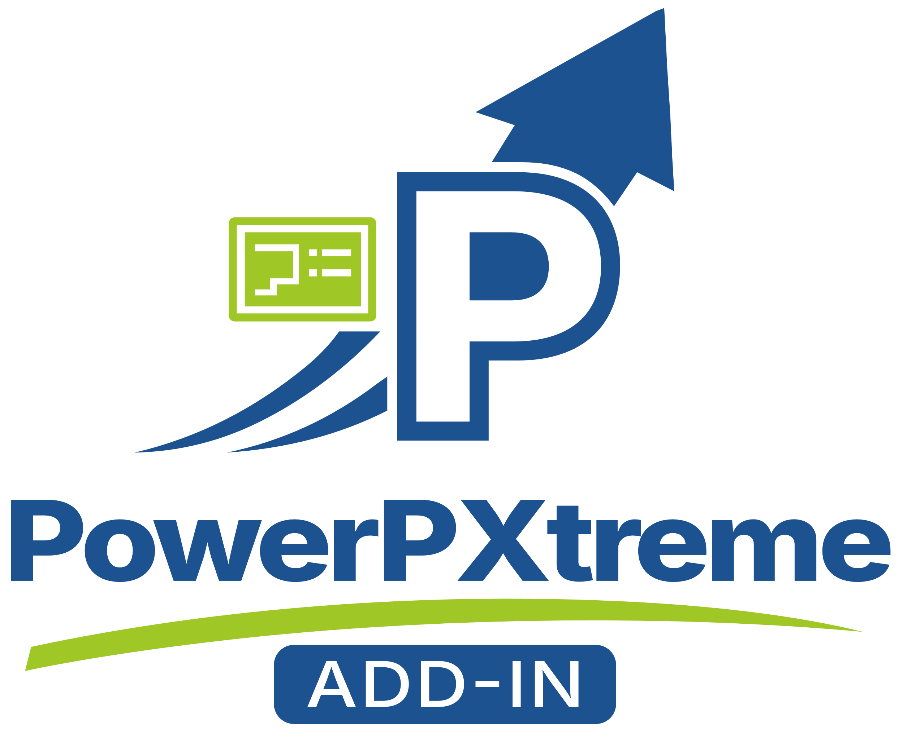

# PowerPXtreme

**Deck production is mostly moving boxes and fixing crops. This ribbon does the moving.**

  

 

## The wall

Sixty slides. The client changed the tagline. Every slide needs the same edit, some are hidden, two are duplicated for variants, and the images came in at six different aspect ratios.

PowerPXtreme handles the repetitive half of deck work: paste across slide sets, arrange objects on a grid, normalize pictures, and clean notes.

## What's on the ribbon

**Smart Paste.** Replace or append tagged content across selected slides, all slides, visible only, hidden only, or newly created ones. The hidden-slide case alone saves an audit pass.

**Layout palette that stays open.** A visual alignment palette you keep next to the slide while arranging objects.

**Align to reference.** Align selected shapes to a reference object with optional exact spacing, keeping the structure intact.

**Grid layout.** Reflow several objects into rows and columns in one action instead of dragging each one.

**Smart crop.** Normalize pictures with crop, fit, fill, match, and slide-bound workflows, so six aspect ratios stop looking like six different decks.

**Sticky notes for review sessions.** A large color library, transparency, custom colors, straight onto the slide.

**Speaker notes cleanup.** Format or remove notes across the current slide, a selection, or the whole deck.

**Clean slide master.** Remove unused master content so the file stays maintainable and doesn't carry a decade of layouts.

High-resolution export rounds it out.

## Who it's for

Consultants and trainers who build decks weekly. Anyone who inherits a 90-slide monster and has to make it consistent by Friday. Teams producing the same deck in several variants.

## Get it

Current builds go to supporters directly rather than through a public download button. Process and delivery steps: [SUPPORT.md](SUPPORT.md)

Support the work: [Ko-fi](https://ko-fi.com/pacosalasv) · [PayPal](https://www.paypal.com/paypalme/pacosalas?locale.x=en_US&country.x=MX) (include the product name and your delivery email in the note)

Bugs and requests: [open an issue](https://github.com/pacosalasv/PowerPXtreme-Support/issues)

  

